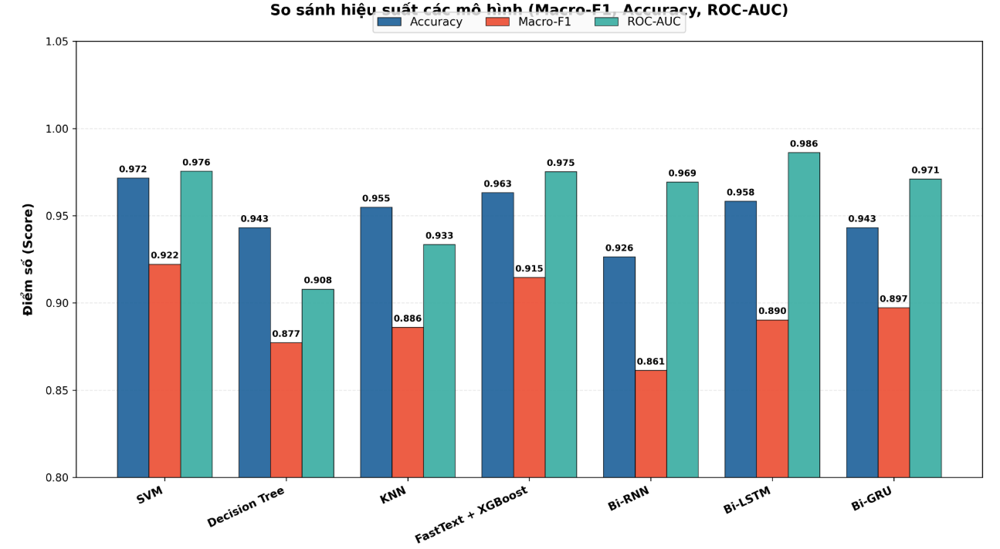
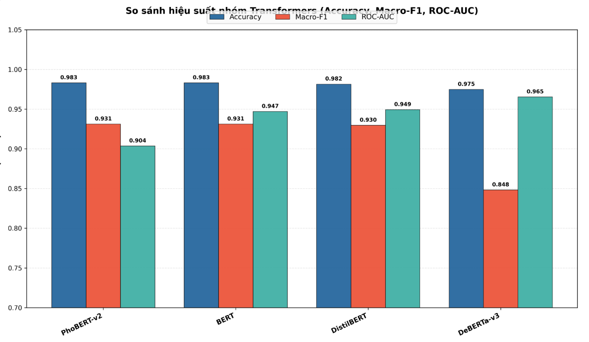
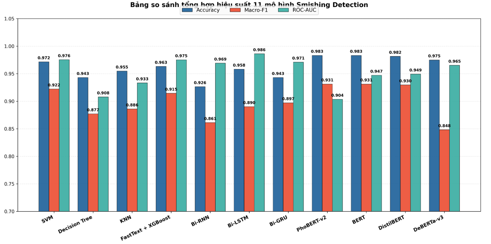

# Phát Hiện Tin Nhắn Lừa Đảo & Tin Nhắn Rác Tiếng Việt

Nhằm phân loại và phát hiện tin nhắn văn bản (SMS) độc hại tiếng Việt với bài toán phân loại **3 lớp (3-Class Classification)**:
- **Lớp 0 (Ham)**: Tin nhắn hợp pháp.
- **Lớp 1 (Spam)**: Tin nhắn rác quảng cáo, tiếp thị thương mại không chứa yếu tố lừa đảo.
- **Lớp 2 (Smishing)**: Tin nhắn lừa đảo tài chính, mạo danh cơ quan/tổ chức, đường link cờ bạc hoặc cài cắm mã độc.

---

## 1. Cấu trúc Thư mục Dự án 

```text
smishing_tiengviet/
├── src/                     # Toàn bộ mã nguồn cốt lõi của pipeline
│   ├── Data_preprocessing.py  # Tiền xử lý văn bản (chuẩn hóa Unicode NFC, che URL/Token nhạy cảm, lọc ký tự đặc biệt)
│   ├── Back_translation.py    # Tăng cường và cân bằng dữ liệu lớp thiểu số bằng kỹ thuật dịch ngược bảo toàn ngữ cảnh.
│   ├── ML_model.py            # Huấn luyện các mô hình Machine Learning gồm SVM (LinearSVC), Decision Tree, KNN và FastText + XGBoost.
│   ├── DL_model.py            # Huấn luyện các mô hình Deep Learning đa phương thức (Multi-modal) gồm Bi-RNN, Bi-LSTM, Bi-GRU.
│   ├── Transformer_model.py   # Huấn luyện các mô hình Pre-trained Transformers gồm PhoBERT-v2, mBERT, DistilBERT, mDeBERTa-v3.
│   ├── metrics.py             # Tính toán 7 chỉ số đánh giá (Accuracy, Precision, Recall, Macro-F1, FPR, FNR, ROC-AUC).
│   ├── visualization.py       # Vẽ biểu đồ cột nhóm so sánh hiệu suất các mô hình bằng Matplotlib.
│   ├── pipeline.py            # Điều phối toàn bộ luồng huấn luyện, đánh giá
│   └── utils.py               # Các hàm tiện ích
├── main.py                  # thực thi
└── README.md                # Tài liệu kỹ thuật chi tiết của dự án
```

---

## 2. Dữ liệu & Ý tưởng Kỹ thuật

### Dữ liệu Thực nghiệm
Dự án sử dụng bộ dữ liệu [Vietnamese Quality-Assured SMS Dataset](https://huggingface.co/datasets/trannguyenthaituan/vietnamese_sms_dataset) trên Hugging Face. Tập dữ liệu phản ánh chính xác phân phối thực tế tại Việt Nam với tỷ lệ mất cân bằng nghiêm ngặt giữa 3 lớp: Ham chiếm ~73.15%, Smishing chiếm ~25.78% và Spam là lớp thiểu số cực đoan chỉ chiếm ~1.07%.

### Kỹ thuật Dịch ngược Bảo toàn Ngữ cảnh (`Back_translation.py`)
Làm phong phú và cân bằng dữ liệu cho các lớp thiểu số (Spam, Smishing) trên tập Train bằng cách dịch tin nhắn sang ngôn ngữ trung gian (Anh, Pháp) rồi dịch ngược lại về tiếng Việt, giúp tạo ra các mẫu câu mới có nội dung tương tự nhưng khác biệt về từ vựng và cấu trúc ký tự (kết hợp cố định các thực thể `[URL]`, `[MONEY]` để không bị dịch sai).
### Kỹ thuật Chuẩn hóa Văn bản (`message_normalizer.py`):
(1) Chuẩn hóa Unicode NFC, xóa ký tự tàng hình (zero-width) và chuyển đổi ký tự đồng hình Cyrillic (а, о, е, с...) về Latinh. 
(2) Khóa bảo vệ các thực thể quan trọng (URL, Domain, thẻ `[URL]`, `[MONEY]`, số tiền, gói cước, mã OTP, chữ viết tắt in hoa như CCCD). 
(3) Ghép lại các từ bị chèn dấu chấm/gạch ngang/khoảng trắng rời rạc (`X.á.c m.i.n.h` -> `Xác minh`) và rút gọn ký tự lặp kéo dài (`khóaaaa` -> `khóa`). 
(4) Giải mã Leetspeak bên trong từ (`@`->`a`, `0`->`o`, `3`->`e`, `4`->`a`, `1`/`!`->`i`, `$`->`s`). 
(5) Chuẩn hóa vị trí dấu thanh tiếng Việt (`khoá` -> `khóa`, `khỏan` -> `khoản`) và phục hồi dấu cho các cụm từ khóa trọng tâm (`Tai khoản` -> `Tài khoản`, `xac minh` -> `xác minh`, `ngan hang` -> `ngân hàng`). 
(6) Mở rộng teencode/viết tắt (`stk`, `sdt`, `mk`, `qk`, `ctv`) và đồng bộ các từ phủ định (`k`, `ko`, `k0`, `kh`, `hok`) về "không" để bảo toàn ý định câu. 

---

## 3. Thiết lập Tham số Mô hình (Hyperparameters Setup)

### Machine Learning
- **Biểu diễn văn bản**:
  - *TF-IDF*: Thiết lập `max_features=5000`, `ngram_range=(1, 2)`.
  - *FastText*: Thiết lập `vector_size=100`, `window=5`, `epochs=15`, phân đoạn từ tiếng Việt bằng thư viện `pyvi`.
- **Cấu hình mô hình**:
  - **SVM (LinearSVC)**: $C = 1.0$, `class_weight='balanced'`, `random_state=42`, `max_iter=3000`.
  - **Decision Tree**: `max_depth=15`, `min_samples_split=5`, `class_weight='balanced'`, `random_state=42`.
  - **K-Nearest Neighbors (KNN)**: `n_neighbors=5`, `weights='distance'`.
  - **FastText + XGBoost**: `n_estimators=150`, `max_depth=5`, `learning_rate=0.08`, `subsample=0.8`, `colsample_bytree=0.8`, `eval_metric='mlogloss'`, `compute_sample_weight('balanced')`.

### Nhóm 2: Deep Learning
- **Tách từ thành token**: Sử dụng `SimpleVocab` với `max_vocab_size=10000`, `max_len=128`, `embed_dim=128`.
- **Mạng nơ-ron hồi quy hai chiều**: Các mô hình `Bi-RNN`, `Bi-LSTM`, `Bi-GRU` với `hidden_dim=128`, `bidirectional=True` ( $128 \times 2 = 256$).
- **Đa phương thức**: Ghép vector ngữ cảnh $256$ chiều (`in_fc_dim = 264`).
- **Tầng phân loại**: Mạng nơ-ron tích hợp:
  $$\text{Linear}(264 \to 64) \;\to\; \text{ReLU} \;\to\; \text{Dropout}(p=0.3) \;\to\; \text{Linear}(64 \to 3)$$
- **Tối ưu hóa**: Huấn luyện trong `epochs=5`, `batch_size=32`, `Adam(lr=1e-3, weight_decay=1e-5)` cùng hàm mất mát `nn.CrossEntropyLoss` tích hợp trọng số lớp nghịch đảo tần suất (`class_weights`).

### Nhóm 3: Pre-trained Transformers
Toàn bộ mô hình ngôn ngữ lớn được đăng ký thêm **9 Special Tokens** (`[URL]`, `[MONEY]`, `[TIME]`, `[DATE]`, `[NUMBER]`, `[NAME]`, `[POINT]`, `[TB]`, `[QC]`) thông qua `tokenizer.add_special_tokens` và đồng bộ trọng số qua `model.resize_token_embeddings`. Cập nhật gradient bằng `AdamW(weight_decay=0.01)`, áp dụng `Linear Warmup Scheduler` (10% số bước) và cắt ngưỡng gradient `clip_grad_norm_ = 1.0`.

| Mô hình         | Max Len | Batch Size | Epochs |    Learning Rate    |
| :-------------- | :-----: | :--------: | :----: | :-----------------: |
| **PhoBERT-v2**  |   128   |     16     |   3    |  $2\times 10^{-5}$  |
| **mBERT**       |   128   |     16     |   3    |  $2\times 10^{-5}$  |
| **DistilBERT**  |   128   |     16     |   5    | $1.5\times 10^{-5}$ |
| **mDeBERTa-v3** |   128   |     16     |   3    | $1.5\times 10^{-5}$ |

---

## 4. Hướng dẫn Chạy Nhanh (Quickstart)

```

### Chạy Thực nghiệm qua Dòng lệnh CLI (`main.py`)

- **Chạy toàn bộ pipeline huấn luyện và đánh giá cả 11 mô hình:**
  ```bash
  python main.py
  ```

- **Tự động kích hoạt cơ chế cân bằng dữ liệu Back-Translation nếu chưa có tập Train cân bằng:**
  ```bash
  python main.py --balance
  ```

- **Bỏ qua nhóm Transformer để kiểm thử nhanh trên CPU (chỉ chạy ML & DL):**
  ```bash
  python main.py --skip-transformer
  ```

- **Bỏ qua nhóm ML hoặc DL để tập trung huấn luyện mô hình Transformer:**
  ```bash
  python main.py --skip-ml --skip-dl
  ```
---

## 5. Kết quả & Biểu đồ Thực nghiệm

Hiệu năng của các mô hình được đo lường toàn diện qua 7 chỉ số: **Accuracy (Acc)**, **Macro-Precision (P)**, **Macro-Recall (R)**, **Macro-F1 (F1)**, **False Positive Rate (FPR)**, **False Negative Rate (FNR)** và **Multi-class ROC-AUC (AUC)**.

### So sánh Hiệu suất Nhóm Machine Learning & Deep Learning
Biểu đồ thể hiện độ chính xác, điểm Macro-F1 và diện tích dưới đường cong ROC-AUC giữa các mô hình ML truyền thống (SVM, Decision Tree, KNN, FastText + XGBoost) và các mô hình Recurrent đa phương thức (Bi-RNN, Bi-LSTM, Bi-GRU):



### So sánh Hiệu suất Nhóm Pre-trained Transformers
Biểu đồ đánh giá năng lực của các mô hình Transformer tiên tiến (PhoBERT-v2, mBERT, DistilBERT, mDeBERTa-v3) sau khi được tinh chỉnh và mở rộng bộ từ vựng định danh:



### Biểu đồ Tổng hợp So sánh Hiệu năng 11 Mô hình
Tổng hợp trực quan sự vượt trội về độ chính xác và khả năng giảm thiểu báo động giả trên toàn bộ 11 kiến trúc thực nghiệm:


